<p align="center">
  <a href="#install">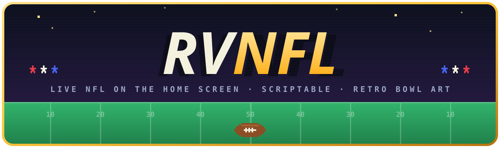</a>
</p>

<p align="center">
  <a href="#install"></a>
  <a href=".github/workflows/daily.yml"></a>
</p>

**RV NFL** is an iPhone widget that follows one NFL club through the season (the **Minnesota Vikings** by default) and
draws it in the pixel art of *Retro Bowl*. It is one script for every widget size, from the lock screen to large,
and it changes with the moment: a live game with the down, distance and drive, the Sunday slate, the final with its
stars and what the result did to the playoff odds, the preview the day before, and rotating cards between games.

This repository is the widget's whole back end, and there is no server: a GitHub Actions job rebuilds the data every
morning from public sources and commits it, and the phone reads the files straight from GitHub.

- **A mode for every moment.** The script picks what to draw each time iOS wakes it, by the clock and the schedule.
- **Real Retro Bowl art.** Game sprites in each club's kit, the game's crowd, stands and turf painted in club colours.
- **Live data with a model behind it.** ESPN's live scoreboard during games; playoff odds from a 10,000-run season
  simulation with the NFL's tiebreakers; season ratings, injuries and depth charts from nflverse.
- **Runs entirely on GitHub.** A daily Actions job, raw GitHub and GitHub Pages; no key, no token, nothing on a Mac.

<p align="center"><b><a href="#install">▶ Install it</a></b> · paste one script into Scriptable · no key needed</p>

---

## Contents

- [It changes with the moment](#it-changes-with-the-moment)
- [Real Retro Bowl art](#real-retro-bowl-art)
- [Live data and the models](#live-data-and-the-models)
- [When it refreshes](#when-it-refreshes)
- [Architecture: it runs on GitHub](#architecture-it-runs-on-github)
- [Install](#install)
- [Repository map](#repository-map)
- [The Retro Bowl line-up](#the-retro-bowl-line-up)
- [Credits](#credits)

---

## It changes with the moment

Every time the widget runs it decides what matters right now, in this order:

| # | When | What it shows |
|---|---|---|
| 1 | **The club's game is live** | The game: score, quarter and clock, down and distance, the ball on a field strip, the current drive, each side's leader, team stats, the last play, win probability and timeouts |
| 2 | **A primetime game is live** | The same live view for that game (Thursday, Sunday and Monday nights, Saturday nights) |
| 3 | **Sunday with games on** | The slate: every game's score and state, close games flagged, the top performer so far; a score ticker on medium and small |
| 4 | **Up to 12 hours after the club's game** | The final: the box score by quarter, the stars of the game, the record and division place, and how the playoff odds moved |
| 5 | **The day before** | The preview: opponent, kickoff in local time, the win chance and line, playoff and division odds, the injury report |
| 6 | **Weekdays** | Rotating between-games cards: the **club card** (record, power rank, next game, the club's best player), the **playoff race** (chance of each seed, division and bye) and the **MVP race** by season rating |
| 7 | **The offseason** | The season in the books |

### Game day

<table>
  <tr>
    <td width="50%">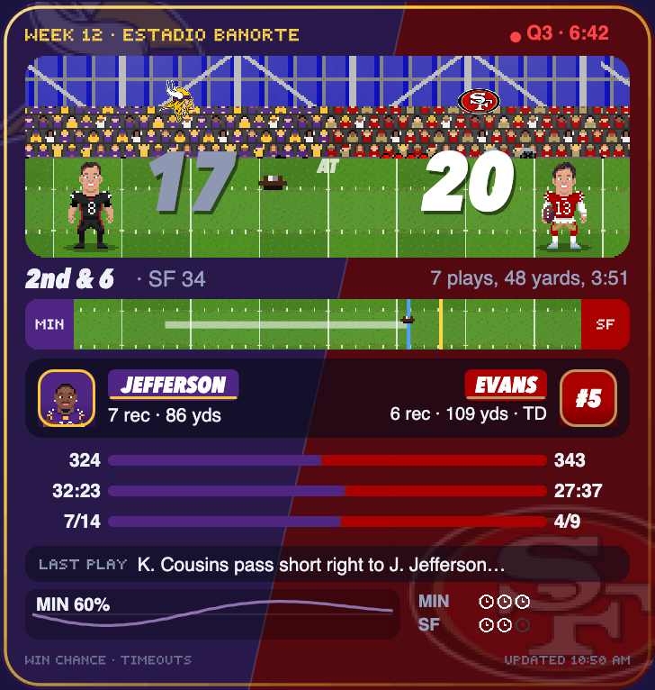</td>
    <td width="50%">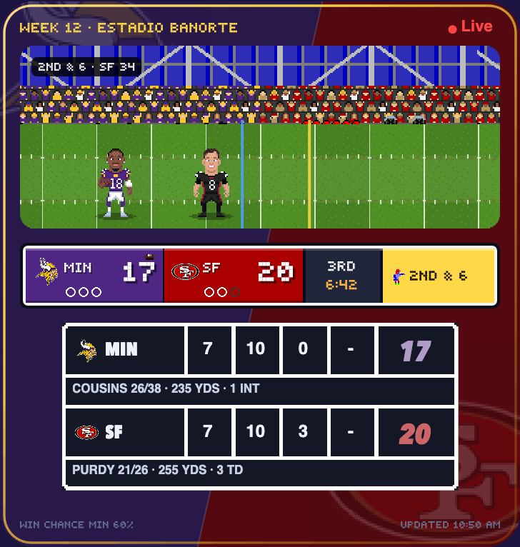</td>
  </tr>
  <tr>
    <td align="center"><b>Live, classic.</b> Score on the turf, the drive on a field strip, leaders, team stats, win probability, timeouts.</td>
    <td align="center"><b>Live, score bug.</b> A broadcast-style pixel score bug over a box score by quarter.</td>
  </tr>
  <tr>
    <td>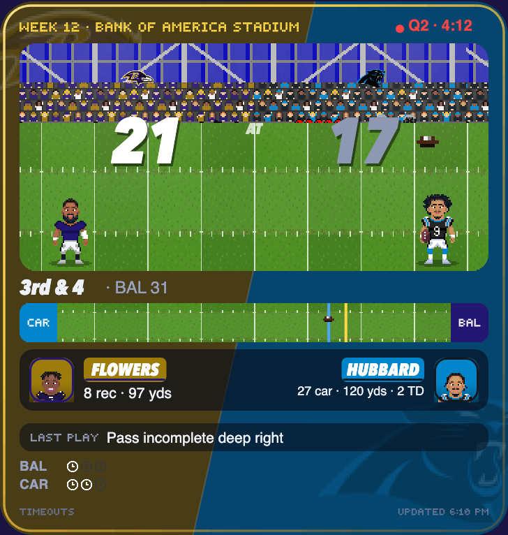</td>
    <td>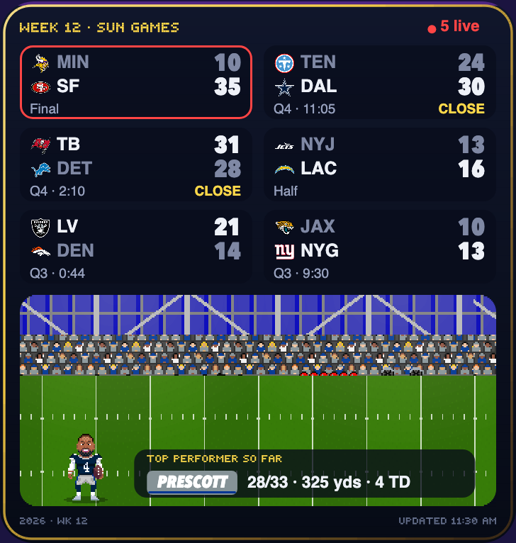</td>
  </tr>
  <tr>
    <td align="center"><b>Primetime.</b> Any night game gets the full live view, in both clubs' colours.</td>
    <td align="center"><b>Sunday slate.</b> Every game at once, close ones flagged, the day's top performer.</td>
  </tr>
  <tr>
    <td>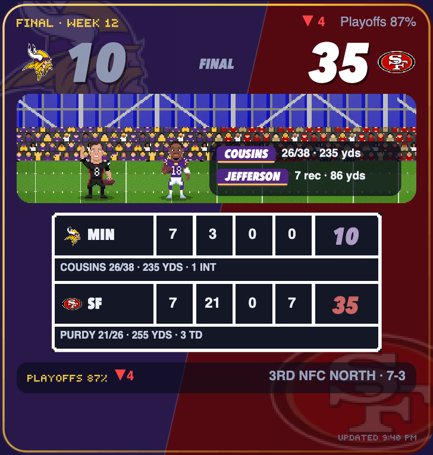</td>
    <td>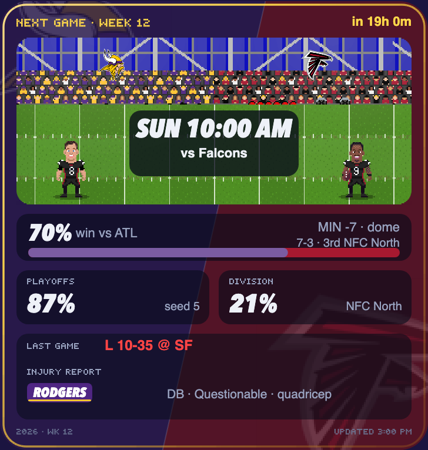</td>
  </tr>
  <tr>
    <td align="center"><b>The final.</b> The stars of the game, the box score and the odds change (▼4).</td>
    <td align="center"><b>The day before.</b> Kickoff, win chance and line, odds, the injury report.</td>
  </tr>
</table>

The live view changes style every 15 minutes (classic and score bug on large; classic, shot and score bug on medium;
live, score bug and duel on small), so a long afternoon doesn't look static. The widget's Parameter can pin one.

### Between games, and the smaller sizes

<table>
  <tr>
    <td width="50%" rowspan="3">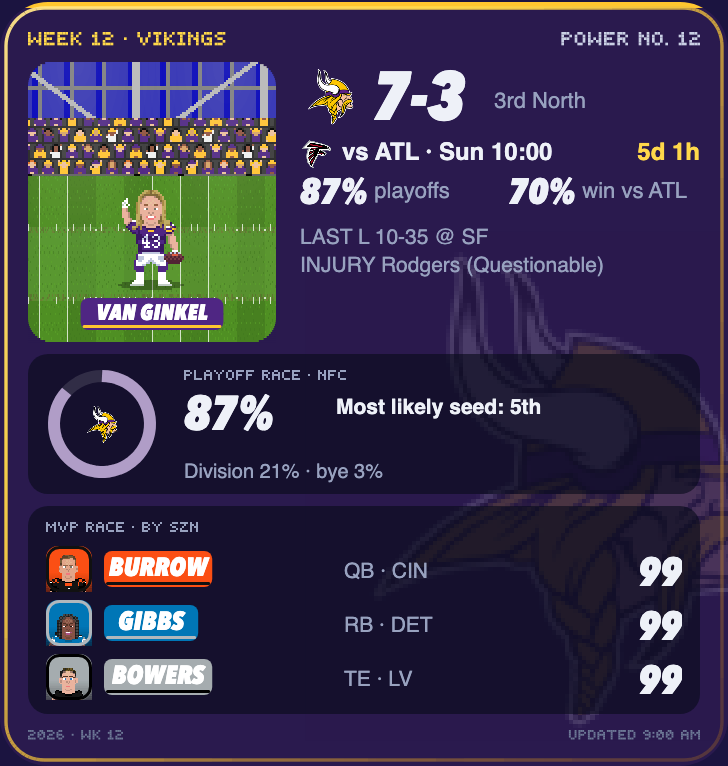</td>
    <td width="50%">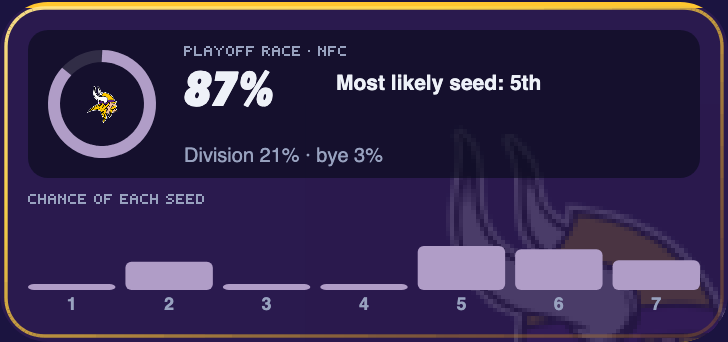</td>
  </tr>
  <tr>
    <td>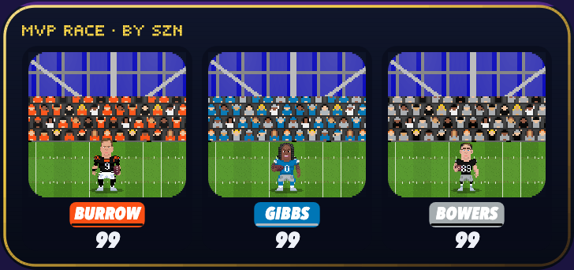</td>
  </tr>
  <tr>
    <td>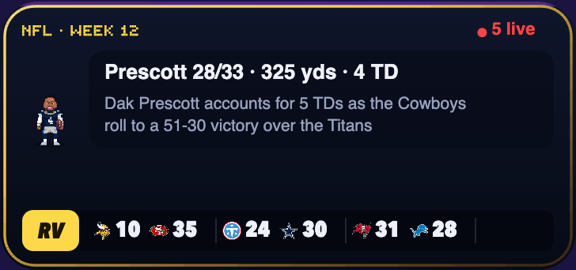</td>
  </tr>
  <tr>
    <td align="center"><b>Club card.</b> Record, power rank, next game, the playoff race and the MVP race.</td>
    <td align="center"><b>Medium.</b> Seed chances, the MVP race in each club's kit, the bottom-line ticker.</td>
  </tr>
</table>

### Lock screen

<table>
  <tr>
    <td align="center"><br><b>Inline</b></td>
    <td align="center">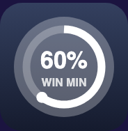<br><b>Circular</b></td>
  </tr>
  <tr>
    <td align="center">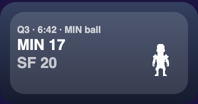<br><b>Rectangular, live</b></td>
    <td align="center">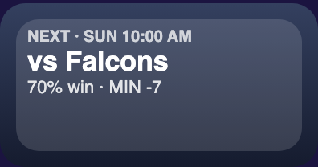<br><b>Rectangular, preview</b></td>
  </tr>
</table>

The lock screen follows the same modes in white so iOS can tint it: the live score with down and distance, a win
chance gauge or a kickoff countdown, the playoff race, the final, the season in the books. The rectangular live view
carries a player's sprite as a white silhouette.

---

## Real Retro Bowl art

Everything is drawn into one `DrawContext` image (rim, club colours, crowd and turf, sprites, pixel text), so a view
looks the same at every size and on every iPhone.

- **Game sprites in each club's kit.** Players are the game's own 64 × 64 sprites, pre-scaled 6× with
  nearest-neighbour pixels so iOS never blurs them, normalised to one anchor (centre line and feet row), with a mirrored
  copy to face the opponent, a celebrating pose for the final, and a white silhouette for the lock screen. About 1,800
  files cover every player the widget may draw.
- **The game's stadium.** The crowd and stands painted in each club's colours (all 32), day and night turf, and a
  split background in both clubs' colours with the logos watermarked behind.
- **The game's own props.** The football, the timeout clocks (on and off), the first-down referee and the scoreboard
  frame come from *Retro Bowl* itself.
- **A pixel score bug and an ESPN-style bottom line.** The broadcast score bug is drawn in pixel type with timeouts and
  the down marker, and Sunday's ticker is a bottom-line bar of compact scores that runs through the slate.
- **Club colours that stay legible.** Official primaries, with the secondary used where a primary is nearly black and a
  lift toward white where a colour would disappear on the dark panels.
- **Error screens in character.** With no connection and nothing cached, the widget draws a night stadium in the style
  of Retro Vault's FUMBLE error screen: a jumbotron with bulbs calling TIMEOUT, the referee's ruling under it, a yellow
  flag and a loose ball on the turf. It is drawn from primitives only, so it works with nothing downloaded.

---

## Live data and the models

| Source | What it feeds | Where |
|---|---|---|
| **ESPN's public scoreboard and summary JSON** | During games: score, clock, possession, down and distance, the drive, leaders, team stats, the last play and win probability (`scoreboard`, then `summary?event=<id>` for the game on screen) | `rv-nfl-widget.js` |
| **nflverse schedules** | Results, kickoffs and closing lines, for the record, division place, power rank, the slate and the playoff model | `scripts/playoff_odds.py`, `scripts/widget_data.py` |
| **nflverse weekly player stats and snap counts** | **SZN**, the season rating behind the MVP race and the club's best player | `scripts/season_ovr.py` |
| **nflverse injuries, rosters and depth charts** | The injury report (status and injury), IR, current clubs and the club's starters | `scripts/injuries.py`, `scripts/depth_charts.py` |

### Playoff odds: a 10,000-run season simulation

`scripts/playoff_odds.py` plays the rest of the regular season 10,000 times and seeds each run's playoffs:

- **Win chance of a game.** Where a closing line is posted, `p(home) = Φ(line / 13.45)`, the usual conversion (an NFL
  margin is roughly normal with a standard deviation of 13.45 points). Otherwise each club's point differential per
  game, shrunk toward zero for small samples, plus home field; the shrink and home edge are fitted by least squares to
  the lines of games already played.
- **The NFL's tiebreakers.** Division ties go head-to-head, division record, common games, conference record, strength
  of victory, strength of schedule; wild-card ties go head-to-head (a sweep when three or more are tied), conference
  record, common games, strength of victory, strength of schedule. The tiebreak restarts whenever a step splits the
  group, and division mates are reduced to one before the conference steps, as the league does.
- **The 7-team format.** Four division winners seeded 1 to 4, three wild cards, a bye for the 1 seed only, 2v7, 3v6,
  4v5, reseeding, and a neutral-site Super Bowl. Each club gets playoff, division, bye, conference and title chances,
  plus the chance of every seed.
- **Clinched and eliminated are proven, never guessed.** The marks come from a bound check on the standings, not from
  the simulation, and the build stops if the two ever disagree. The same check finds the shortest combinations of the
  coming week's results that would clinch or eliminate.
- **Deterministic.** The simulation is seeded by season and week, so two runs on the same data are byte-identical.

The day-before win chance uses the same model, and the final shows the change in playoff odds from the run before the
game.

### SZN: a rating for the season in progress

`scripts/season_ovr.py` sums each player's regular-season game lines (plus games he played with snaps but no stat
line), scores them at a 17-game pace with an efficiency term from EPA, discounts thin playing time by snap share,
shrinks small samples toward the position, and maps the rank within each position to a 62–99 rating. It is the same
rule the Retro Vault NFL edition uses, on the same files.

---

## When it refreshes

A widget can't run on its own schedule; it hands iOS a `refreshAfterDate`. RV NFL picks that date from the schedule:

| Situation | Next refresh |
|---|---|
| The club's game is live | every **5 minutes** (about the shortest interval iOS honours) |
| Other games are live | every **10 minutes** |
| Sunday slate between windows | within 10 minutes |
| After the club's game (the final window) | within 60 minutes |
| A game is coming | **at kickoff**, waking exactly then |
| Otherwise | the next morning at 7 am |

- **Kickoffs are stored in UTC** and shown in the phone's local time, so the countdown and the wake-up are right in
  any time zone.
- **Primetime is judged on US Eastern time**, the league's own clock (7 pm Eastern or later, with the daylight-saving
  rule computed in the script), so a trip west or abroad never turns Sunday Night Football into an afternoon game.
- **Cached at every step.** `widget.json` and every ESPN response are cached on the phone, so the widget still draws
  offline with the last thing it saw. iOS treats the date as a hint, so Low Power Mode can delay a refresh.

---

## Architecture: it runs on GitHub

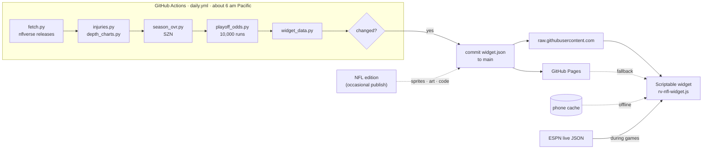

- **A daily job, nothing on a Mac.** `.github/workflows/daily.yml` runs at 14:07 UTC (6:07 am Pacific in winter,
  7:07 am in summer) and on demand (`gh workflow run daily.yml`). It downloads the season's public nflverse files
  (games, injuries, rosters, depth charts, weekly player stats, snap counts), runs the five scripts in order and
  commits `widget.json` only when it changed. Python standard library only: no `pip install`.
- **Served three ways.** The widget reads raw GitHub first, then the same file on GitHub Pages, then its own cache.
  The workflow makes sure Pages rebuilds when a push didn't start a build by itself. No key, no token, no API rate limit.
- **The code updates itself.** The installer pasted into Scriptable is a small loader: on every run it downloads the
  latest `rv-nfl-widget.js` from this repository (raw, then Pages), checks it is really the script, keeps the last good
  copy for offline use and runs it. A fix pushed here reaches every phone at its next refresh.
- **Sprites are pre-drawn, never drawn in CI.** Art changes rarely, so it is published by hand from the local Retro
  Vault NFL edition, only now and then: new players' sprites or a code change. That publish pre-draws every active
  player the widget might need (every club's six best skill players and both depth-chart quarterbacks, the MVP race's
  ten, everyone on the followed club with a game), writes `inputs/` (players with their nflverse and ESPN ids and
  clubs, the art paths), copies the sprites, art and script, and starts the workflow. A player with no sprite yet is
  drawn without one (a logo or his number), never as a broken image.

---

## Install

1. Install [Scriptable](https://apps.apple.com/app/scriptable/id1405459188) on the iPhone.
2. In Scriptable, create a new script, paste the contents of [`rv-nfl-install.js`](rv-nfl-install.js) and name it
   **RV NFL**. Run it once.
3. On the home screen (or lock screen), add a **Scriptable** widget at any size, tap it while editing, and choose
   **RV NFL** as the script.
4. Optional, the widget's **Parameter** field:

| Parameter | Effect |
|---|---|
| *(empty)* | Tapping the widget opens the NFL edition site, [sakisaki-dev.github.io/RetroVault-NFL](https://sakisaki-dev.github.io/RetroVault-NFL/) |
| `bug` | Pins the live view to the broadcast score-bug style |
| `classic` | Pins the live view to the classic style |
| a Shortcut's name | Tapping runs that Shortcut |
| a URL | Tapping opens it |

`bug` and `classic` can sit alongside a Shortcut name or URL in the same field. No key or account is needed; the
installer keeps itself and the widget code current.

**Following another club.** The data build follows `RV_NFL_CLUB` (an nflverse abbreviation, `MIN` by default) in
`scripts/widget_data.py`; a fork can set it in the workflow's environment. Sprites exist for every club's leading
players, so other clubs draw too.

---

## Repository map

```text
rv-nfl-widget/
├─ rv-nfl-widget.js      the widget: one Scriptable script for every size and the lock screen
├─ rv-nfl-install.js     the installer to paste into Scriptable (loads and caches the widget code)
├─ widget.json           the daily data feed the widget reads (about 40 KB)
├─ scripts/              the daily build, Python standard library only
│  ├─ fetch.py           download the season's nflverse files into cache/
│  ├─ injuries.py        the injury report, IR and current clubs
│  ├─ depth_charts.py    each club's starters
│  ├─ season_ovr.py      SZN, the season rating
│  ├─ playoff_odds.py    10,000-run simulation, tiebreakers, clinch scenarios, win chances
│  ├─ widget_data.py     assembles widget.json for the followed club
│  └─ common.py          shared paths and helpers
├─ inputs/               from the NFL edition: players with ids and clubs, ESPN ids, art paths
├─ widget-sprites/       pre-scaled game sprites (figure, mirrored, celebrating, silhouette)
├─ widget-art/           crowd and stands per club, turf, football, timeout clocks, first-down ref, scoreboard
├─ docs/                 README art and screenshots
└─ .github/workflows/    daily.yml, the morning build
```

`cache/` and `work/` are the build's scratch space and are not committed.

---

## The Retro Bowl line-up

RV NFL is the newest piece of a set of projects built around *Retro Bowl*:

- **[Trading Floor](https://github.com/sakisaki-dev/trading-floor)** ([run it in the browser](https://sakisaki-dev.github.io/trading-floor/)):
  the AI bot simulator, an agent-based market where about 500 neural-network bots trade football cards and evolve
  their own tactics.
- **[Retro Vault](https://github.com/sakisaki-dev/RetroVault)** ([live site](https://sakisaki-dev.github.io/RetroVault/)):
  a static, phone-first analytics platform for one long-running Retro Bowl league, with an event-sourced data
  pipeline, a deterministic build, generated news, a card economy and its own Retro Bowl widget. This widget shares
  its look, its sprite rules and its error screen.
- **Retro Vault NFL edition:** the same platform on real NFL data from nflverse, where SZN, the playoff model and the
  sprites in this repository come from.
- **RV NFL** (this repository): the live NFL season on the home screen.

---

## Credits

- **Data:** [nflverse](https://github.com/nflverse/nflverse-data) (CC-BY 4.0): schedules, lines, injuries, rosters,
  depth charts, player stats and snap counts.
- **Live scores:** ESPN's public scoreboard and summary endpoints, read directly by the widget during games. Club logos
  are ESPN's.
- **Art:** the player sprites, crowd, stands, turf, football, timeout clocks, referee and scoreboard frame are
  *Retro Bowl* art by [New Star Games](https://www.newstargames.com/), used for a personal fan project with no
  affiliation.

**Not affiliated with the NFL.** This is an unofficial fan project. It is not affiliated with, endorsed by or sponsored
by the National Football League, the NFL Players Association, any NFL club, ESPN or New Star Games. Team names, logos
and player names belong to their respective owners and are used only to identify the teams and players being followed.

Built by [sakisaki-dev](https://github.com/sakisaki-dev).

<p align="center">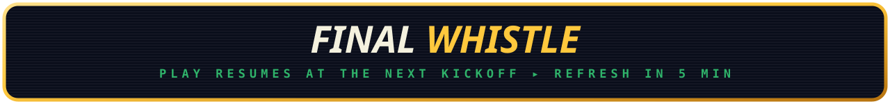</p>
